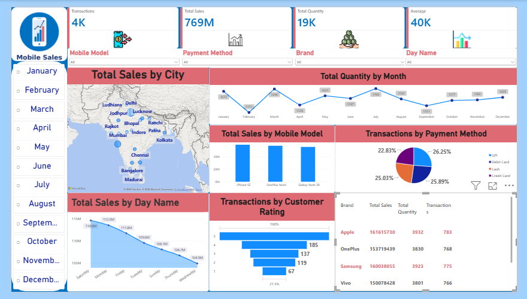

# 📱 Mobile Sales Dashboard — Power BI

I built this dashboard to practice turning raw sales data into something a manager could understand in about ten seconds. It covers mobile phone sales by model, city, payment method and month, and everything responds to one month filter on the left.

> This is an unofficial learning project. Brand names and logos belong to their respective owners.

## What I wanted to find out

- How much did we sell overall, and across how many transactions?
- Which phone models bring in the most money?
- Which cities are the strongest markets?
- How does the quantity sold move from month to month?
- How do customers prefer to pay?

## What's on the dashboard

| Section | Visual | What it tells you |
|---|---|---|
| Top strip | KPI cards | Transactions, total sales, total quantity and average sale at a glance |
| Left side | Month slicer | Filters every visual at once |
| Sales by City | Map | Where the money is coming from |
| Monthly Quantity Trend | Line chart | How sales volume rises and falls over time |
| Sales by Mobile Model | Column chart | Which models are the best sellers |
| Transactions by Payment Method | Pie chart | Share of each payment type |

## How the data is set up

The model is a single table, `Sales-Data`, with mobile model, city, payment method, date, total sales and quantity. I wrote four DAX measures on top of it: **Transactions**, **Total Sales**, **Total Quantity** and **Average**, and designed the layout and KPI icons myself.

## Try it yourself

1. Install [Power BI Desktop](https://powerbi.microsoft.com/desktop/) (it's free, Windows only).
2. Download `dashboard_powerbi.pbix` from this repo.
3. Open it and click through the month slicer to see how the numbers change.

## What I learned

- Planning the layout first (filters on the left, KPIs on top, details below) saves a lot of rework.
- Small details matter: clear chart titles, consistent names and aligned visuals make a dashboard feel professional.
- Writing DAX measures is cleaner than dragging raw columns into visuals.

## What I'd do next

- Add a proper Calendar table and show month-over-month change on the KPI cards.
- Add a Top 5 models view.
- Add drill-through so you can click a city and see its details.

## Tools used

Power BI Desktop · DAX · Power Query

## About me

Hi, I'm Farhana ashraf ganaie, learning data analytics and building projects to practice. I'd love feedback.

Connect with me on [LinkedIn]www.linkedin.com/in/
farhana-ashraf-ganaie-8b188529b

